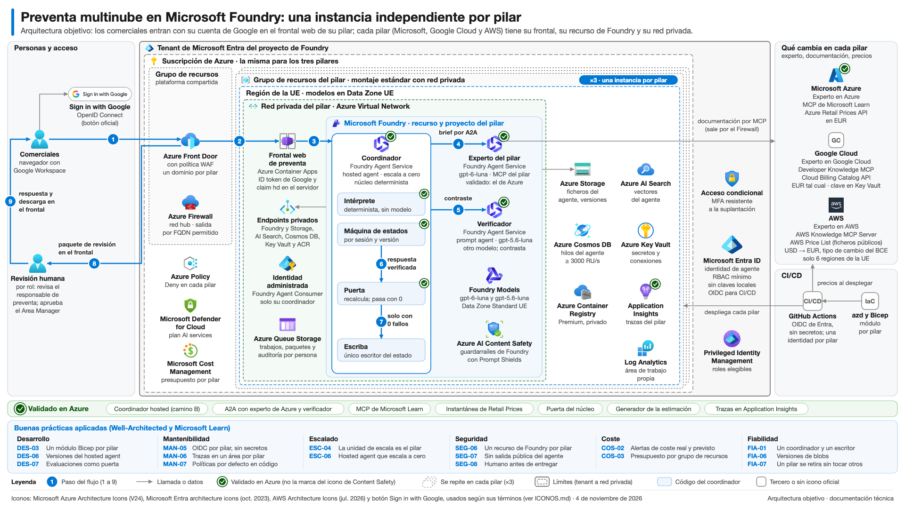

# Preventa multinube en Microsoft Foundry

Sistema de agentes que prepara la propuesta técnica y económica de una preventa a partir de la reunión con el cliente
(la transcripción, las notas del comercial o las dos). Hay **una instancia independiente por pilar**: Microsoft, Google
Cloud y AWS. Las tres se ejecutan en **Microsoft Foundry**; lo que cambia de un pilar a otro es el experto, su
documentación y sus precios.

El sistema **nunca envía nada al cliente**. Prepara un paquete de revisión que revisan y aprueban personas: lo revisa el
responsable de preventa y lo aprueba el responsable de área. Todo lo que hay en este repositorio usa **datos
sintéticos**: los clientes (Kelvara, Hostelia, Brezalia…) y las personas de las transcripciones son inventados.



Versión en inglés, SVG, HTML y fichero editable de diagrams.net en [docs/arquitectura/](docs/arquitectura/README.md).

> El sistema anterior que había en este repositorio (ofertas y arquitectura de IA) sigue en la historia de git, en el
> commit `82c1815`.

## Cómo funciona

1. **El comercial entra por un frontal web propio** de su pilar. Da de alta la solicitud: cliente, código, título,
   términos sensibles, la transcripción de la reunión (`.txt`, `.vtt` o `.docx`) y su explicación.
2. **El coordinador** recibe la solicitud. Es un *hosted agent* de Foundry que lleva dentro un **núcleo determinista**
   (`sandbox/nucleo/`): una máquina de estados que decide cada paso. Los modelos proponen y el código comprueba; lo que
   no se puede comprobar se declara en la nota de revisión.
3. Si falta información, el coordinador **pregunta al comercial** con opciones cerradas y espera su respuesta.
4. Con la información completa, el núcleo genera un **brief anonimizado** y lo envía por A2A al **experto de la nube**
   del pilar. El experto propone la arquitectura con referencias a la documentación oficial. Los precios no los escribe
   el modelo: el núcleo los pone desde una instantánea oficial de precios tomada al desplegar.
5. **El verificador**, otro agente con un modelo distinto, contrasta cada referencia y cada componente.
6. **La puerta** (`verificar_paquete.py`) recalcula el paquete en local con réplicas propias del núcleo. Solo deja
   pasar un paquete con cero fallos.
7. El resultado es un **paquete de revisión**: presentación para el cliente, nota de revisión interna, anexo de
   consumo y estimación. Después llega la **revisión humana**, con las decisiones registradas contra la huella del
   contenido.

## Qué está validado y qué está previsto

| Pieza | Estado |
|---|---|
| Pilar Microsoft | **Funciona de punta a punta en Azure**: coordinador *hosted*, A2A con el experto de Azure y el verificador, MCP de Microsoft Learn, instantánea de Retail Prices, puerta, generador de la estimación y trazas en Application Insights. |
| Pilar AWS | Catálogo y **precios reales en EUR** (de la AWS Price List, en USD y convertidos con el tipo del BCE). El experto de AWS **no está desplegado**. |
| Pilar Google Cloud | Catálogo listo. Sus **precios están sin verificar**: no hay clave de la Cloud Billing Catalog API y la instantánea falla en alto mientras falte. |
| Modelos por defecto de cada pilar | **Pendientes de elegir** entre los modelos de Foundry. Los agentes del sistema usan siempre modelos de Foundry, no los de Google ni los de AWS. |
| Frontal | v1 **local y sin inicio de sesión**. Solo funciona el pilar Microsoft; Google Cloud y AWS aparecen deshabilitados. El inicio de sesión con Google está previsto para producción. |
| Infraestructura | Escrita en **Bicep** y validada en local (compila y pasa el linter sin avisos). **No se ha desplegado** ni probado con `what-if`. El coste fijo mensual está calculado en [infra/COSTE-FIJO.md](infra/COSTE-FIJO.md). |

## Decisiones

- **AWS**: solo regiones de la UE (una lista blanca de seis) y siempre en EUR. AWS publica en USD; el código convierte
  con el tipo del BCE y la oferta avisa de que la conversión es informativa.
- **Google Cloud**: en EUR tal cual lo devuelve la Cloud Billing Catalog API con `currencyCode=EUR`, sin convertir.
- **Notas del comercial**: cuentan como fuente, igual que la transcripción. Una solicitud puede llegar solo con
  notas; en ese caso la nota interna y el mensaje al revisor dicen que no hubo grabación. La transcripción es opcional.
- **Una instancia por pilar** en la misma suscripción, cada una en su grupo de recursos y con su red privada. Retirar
  un pilar no toca a los otros.

## Estructura

| Ruta | Qué hay |
|---|---|
| `sandbox/nucleo/` | Núcleo determinista: estado, suficiencia, brief, experto, verificación, anexo, estimación, documentos y paquete. |
| `sandbox/preventa_run.py`, `sandbox/preventa_api.py` | CLI y API del núcleo ([docs/I1/API-NUCLEO.md](docs/I1/API-NUCLEO.md)). |
| `hosted/` | El coordinador como *hosted agent* de Foundry ([hosted/LEEME.md](hosted/LEEME.md)). |
| `verificar_paquete.py` | La puerta local. |
| `catalogo/` | Catálogo de servicios de Azure con plantillas de precio y su instantánea; `catalogo/aws/` y `catalogo/gcp/`, los de los otros pilares. |
| `agentes/` | Instrucciones de los agentes (`agentes/aws/` y `agentes/gcp/`, borradores de los expertos) y guiones de roles. |
| `esquemas/` | Contratos JSON con ejemplos sintéticos; [esquemas/MULTINUBE.md](esquemas/MULTINUBE.md) y [esquemas/NOTAS_COMERCIAL.md](esquemas/NOTAS_COMERCIAL.md). |
| `frontal/` | Frontal web (BFF en Python y React) ([frontal/README.md](frontal/README.md)). |
| `infra/` | Bicep de la plataforma y de cada pilar, y el cálculo del coste fijo ([infra/README.md](infra/README.md)). |
| `lib/`, `observabilidad/` | Autenticación con tenant fijo, cliente REST de Foundry, trazas y consultas de Application Insights. |
| `docs/` | Diagrama de arquitectura y contratos del núcleo ([docs/I1/CONTRATOS.md](docs/I1/CONTRATOS.md)). |
| `tests/` | Batería de pruebas. `tests/insumos/` lleva una tarifa **sintética** y otros datos de prueba. |
| `herramientas/barrido_publicacion.py` | Barrido previo a publicar (ver «Reglas»). |
| `config/` | Plantillas de configuración (`*.ejemplo*`). Los valores reales van en ficheros locales que git ignora. |

## Configuración

El código lee el entorno real de `config/entorno.local.json`, que no se versiona (o de la ruta que indique
`PREVENTA_ENTORNO`). Créalo a partir de [config/entorno.ejemplo.json](config/entorno.ejemplo.json) con tu tenant,
suscripción, recurso, proyecto e identidades. Si falta, el código falla en alto y no usa la plantilla.

Hay otros activos que tampoco se publican y que el código busca en local:

- **La tarifa**: `salidas/rate-card.json` (o `PREVENTA_RATE_CARD`). Las pruebas usan la tarifa sintética de
  `tests/insumos/rate-card.sintetica.json`, que no tiene relación con ninguna tarifa real.
- **El generador y la plantilla de la estimación**: `PREVENTA_GENERADOR` y `PREVENTA_PLANTILLA`, o la carpeta de
  `PREVENTA_PROYECTOS`.
- **El registro del despliegue**: `manifiesto.json` (plantilla en [manifiesto.ejemplo.json](manifiesto.ejemplo.json))
  y `agentes/despliegue.json`, que escribe `desplegar.py`.

## Pruebas en Mac

Con Python 3.13 y [uv](https://docs.astral.sh/uv/), y un entorno virtual fuera del repositorio:

```bash
uv venv /tmp/venv-preventa -p 3.13
uv pip install -p /tmp/venv-preventa -r requirements.txt -r hosted/requirements.txt -r frontal/bff/requirements.txt
/tmp/venv-preventa/bin/python -I -m pytest -q -p no:cacheprovider -rs
```

Las pruebas que necesitan algo que no se publica **se omiten y dicen qué falta**. Salen en el resumen con `-rs`:

- `EVIDENCIA NO PUBLICADA`: comparan con paquetes y estados de ejecuciones reales (`pruebas/`, `_baseline/`) o con
  notas de cambio por tanda (`docs/I1/CAMBIOS-*`).
- `ACTIVO PRIVADO`: necesitan el generador canónico de la estimación o la tarifa real.
- `FICHERO LOCAL NO PUBLICADO`: necesitan el registro de un despliegue real (`manifiesto.json`).

Diagrama, frontal e infraestructura:

```bash
/tmp/venv-preventa/bin/python -I -m pytest -q -p no:cacheprovider docs/arquitectura/tests/test_diagrama.py
npm --prefix frontal/web ci && npm --prefix frontal/web test
(cd frontal/web && npx playwright install chromium && npx playwright test)   # recorrido en reproducción + axe
bash infra/comprobar.sh                                                        # necesita la CLI de Bicep
```

## Arrancar el frontal

```bash
uv venv -q -p 3.13 frontal/.venv && uv pip install -q -p frontal/.venv/bin/python -r frontal/bff/requirements.txt
npm --prefix frontal/web ci && npm --prefix frontal/web run build
frontal/.venv/bin/python frontal/bff/servidor.py --reproduccion
```

Abre <http://127.0.0.1:8765>. Con `--reproduccion` no se llama a Foundry: el BFF devuelve en orden turnos ya
guardados de una ejecución real con un cliente sintético, saneados, y un paquete reducido. La interfaz lo avisa en
pantalla. Sin `--reproduccion` llama al coordinador desplegado: necesita `config/entorno.local.json` y una sesión de la
CLI de Azure en ese tenant (`az login --tenant <tu tenant>`).

## Reglas

- **Sin datos de clientes.** Todo cliente, persona y transcripción del repositorio es sintético.
- **Sin secretos ni identificadores reales.** Ni claves, ni tokens, ni tenants, suscripciones, recursos o identidades
  de un entorno concreto: van en ficheros locales que git ignora.
- **Sin tarifas reales.** Ni horas, ni perfiles con su precio, ni tarifas: las pruebas usan una tarifa sintética.
- **Barrido antes de publicar.** `herramientas/barrido_publicacion.py` busca en todo lo que git publicaría los
  términos de una lista local que no se versiona (plantilla en
  [config/terminos-prohibidos.local.txt.ejemplo](config/terminos-prohibidos.local.txt.ejemplo)), patrones de secreto
  y cualquier GUID que no sea un identificador público de Azure. Su código de salida es el veredicto: 0 limpio,
  1 hallazgos, 2 configuración inválida.

```bash
python3 -I herramientas/barrido_publicacion.py --terminos <lista local de términos>
```
