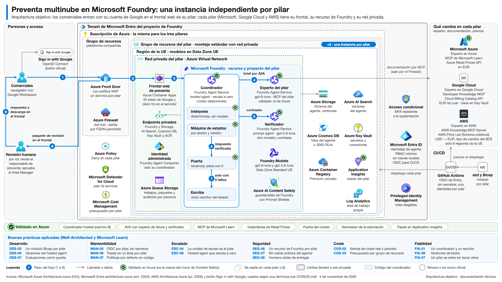

# Arquitectura objetivo de la preventa multinube



Versión en inglés: [arquitectura.en.png](arquitectura.en.png). Editable en diagrams.net:
[arquitectura.drawio](arquitectura.drawio), con una página por idioma. SVG y HTML autocontenidos:
`arquitectura.es.svg`, `arquitectura.en.svg`, `arquitectura.es.html`, `arquitectura.en.html`.

Este diagrama es la **arquitectura objetivo** del sistema de preventa cuando se monte como un proyecto real:
**una instancia independiente por pilar** (Microsoft, Google Cloud y AWS), todas ejecutándose en Microsoft
Foundry. No es una foto de lo que hoy está desplegado: lo que ya se ha probado en Azure lleva un sello verde
y lo que la implementación actual hace de otra manera se explica en
[En qué difiere hoy la implementación](#en-qué-difiere-hoy-la-implementación).

Es documentación técnica, no una pieza de marketing (los términos de los iconos lo exigen, ver
[ICONOS.md](ICONOS.md)). La especificación ([arquitectura.json](arquitectura.json)) no contiene nombres de
empresas, clientes ni personas, identificadores de tenant o de suscripción, tarifas, correos ni secretos.

**Fuentes.** Todo lo que dice el diagrama sale de dos estudios internos verificados el 04-11-2026 (Azure por un
lado; AWS y Google Cloud por otro), que no se publican. Los identificadores entre paréntesis (ID-4, RED-3, T5…)
remiten a esos estudios. Cada práctica y cada enlace a Microsoft Learn que aparece en el diagrama está en
[arquitectura.json](arquitectura.json) con su URL y su cita literal, y `verificar_citas.py` las comprueba.

## Cómo leerlo

**Se dibuja una instancia de pilar en detalle, marcada «×3 · una instancia por pilar»** (las dos tarjetas de
detrás indican que se repite). Las tres instancias son el mismo módulo Bicep con parámetros distintos; lo
único que cambia entre ellas está en el recuadro **«Qué cambia en cada pilar»**, a la derecha.

**Los límites van de fuera adentro.** Cada marco es un límite de seguridad y de gobierno:

1. **Tenant de Microsoft Entra del proyecto de Foundry.** Dentro, los servicios globales de identidad:
   Microsoft Entra ID (identidad de agente, RBAC de mínimo privilegio, sin claves locales, OIDC para la
   CI/CD), Acceso condicional con MFA resistente a la suplantación y Privileged Identity Management con roles
   elegibles (ID-1 a ID-8).
2. **Suscripción de Azure, la misma para los tres pilares** (opción B del estudio de Azure). Aquí actúan Azure
   Policy (guardarraíl obligatorio, modelos aprobados, sin clave local y red cerrada, con `Deny` sobre el
   grupo de recursos de cada pilar), Microsoft Defender for Cloud (plan AI services, que es un conmutador de
   suscripción) y Microsoft Cost Management (un presupuesto por grupo de recursos de pilar; avisa, no corta).
3. **Dos tipos de grupo de recursos, hermanos dentro de la suscripción.** El de **plataforma compartida**
   (Azure Front Door con WAF y Azure Firewall en la red *hub*) y el **del pilar**, que se repite tres veces.
4. **Región de la UE**, con los modelos en Data Zone UE.
5. **Red privada del pilar** (Azure Virtual Network): montaje estándar con red privada, sin salida pública
   del agente (RED-2). Dentro están el frontal web de preventa, los endpoints privados y el recurso y proyecto de
   Microsoft Foundry del pilar. Storage, AI Search, Cosmos DB, Key Vault, Container Registry, Application
   Insights y Log Analytics son del pilar pero quedan fuera del marco de la red: se llega a ellos por sus
   endpoints privados (RED-3, RED-4).

**Fuera del tenant del proyecto:**

- **Personas y acceso.** Los comerciales y la revisión humana, desde el navegador con su cuenta de Google
  Workspace corporativa, e **Sign in with Google** (OpenID Connect), el proveedor de identidad. No necesitan
  cuenta de Entra ni permisos de Foundry.
- **CI/CD.** GitHub Actions con OIDC de Entra (una identidad de despliegue por pilar, sin secretos) y azd con
  Bicep (un módulo por pilar). La CI/CD también descarga la instantánea de precios al desplegar.

**Lo que dibuja cada forma:** iconos oficiales con el nombre completo del servicio junto a cada uno; formas
neutras con texto para terceros o piezas sin icono oficial (Google Cloud, GitHub Actions, azd y Bicep); el
botón oficial completo de Sign in with Google, nunca la «G» sola; cajas claras dentro del coordinador para el código determinista del núcleo; límites con trazo
continuo (tenants) o discontinuo (suscripción, grupos de recursos, región y red privada).

## El flujo, paso a paso

1. **El comercial entra en el frontal web de su pilar** con Sign in with Google y sube la transcripción. El
   tráfico pasa por **Azure Front Door con WAF**, con un dominio por pilar.
2. **Front Door lo lleva al frontal del pilar** (Azure Container Apps, por Private Link: N13). El frontal
   **valida en el servidor** el ID token de Google: firma, `aud`, `iss` y `exp`, y además el claim **`hd`**
   del dominio corporativo y `email_verified`. El parámetro `hd` de la petición solo optimiza la pantalla y
   cualquiera lo puede quitar; Google dice del claim: «This must be used when restricting access to a resource
   to only members of certain domains.», y que el dominio del correo no basta (el estudio de AWS y Google §6.A). La
   autenticación integrada de Container Apps («Easy Auth») puede hacer el inicio de sesión con Google, pero no
   restringe por dominio: deja la autorización al código («Finer authorization, such as role-specific
   authorization, can be handled by inspecting the user's claims», `azure/container-apps/authentication`,
   consultada el 04-11-2026; la restricción por `hd` es deducción de las dos fuentes). Después el frontal
   autoriza con la lista de personas del pilar, usando el `sub` de Google como clave y no el correo, y encola
   el trabajo en su propia cola (Azure Queue Storage).
3. **El frontal llama al coordinador** con su identidad administrada, que solo tiene el rol Foundry Agent
   Consumer sobre el coordinador de su pilar (N12, ID-4). La auditoría por persona (identificador de Google,
   dominio, pilar, id de petición, huella de la transcripción, id de la ejecución) la lleva el frontal en su
   tabla y en el Application Insights del pilar, porque Foundry solo ve la identidad del frontal (estudio de Azure
   §6b.4).
4. **El coordinador delega en el experto del pilar por A2A** con un brief anonimizado. El coordinador es un
   *hosted agent* con núcleo determinista: el intérprete clasifica sin modelo, la máquina de estados decide
   cada paso por sesión y versión, la puerta recalcula y el escriba es el único que escribe el estado. El
   experto busca primero arquitecturas de referencia oficiales en la documentación de su nube por MCP.
5. **El verificador contrasta** cada referencia y componente, con otro modelo (`gpt-5.6-luna`).
6. **La respuesta verificada pasa a la puerta.** Los precios los pone el código desde la instantánea, nunca
   el modelo.
7. **La puerta solo deja pasar con 0 fallos** y el escriba guarda el resultado.
8. **Revisión humana, por rol.** El paquete de revisión (PPTX, DOCX y XLSX) se ve y se descarga en el mismo
   frontal, también tras Front Door y con inicio de sesión de Google: lo revisa el responsable de preventa y
   lo aprueba el Area Manager. El sistema nunca envía nada al cliente (IA-8).
9. **Respuesta y descarga en el frontal** para quien lo pidió, cuando la versión está aprobada.

## Una instancia por pilar: qué se comparte, qué se repite y qué cambia

**Se comparte (plataforma):** el tenant de Entra, la suscripción, Azure Policy, Defender for Cloud, Cost
Management (con un presupuesto por pilar), Azure Front Door con WAF, Azure Firewall en la red *hub* y la
CI/CD con GitHub Actions, OIDC, azd y Bicep.

**Se repite en cada pilar (el grupo de recursos apilado):** un recurso de Foundry con su proyecto, red
privada propia con subred delegada de agentes y subred de endpoints privados, Storage, AI Search y Cosmos DB
propios (≥ 3000 RU/s; el vínculo del proyecto con los tres no se puede cambiar después, RED-5), Key Vault,
Container Registry Premium, Application Insights y Log Analytics propios, el frontal web con su identidad,
cola y tabla, el coordinador, el experto, el verificador, los despliegues de `gpt-6-luna` y
`gpt-5.6-luna` en Data Zone UE y la política de guardarraíles con Prompt Shields. Learn lo marca como regla
para producción: «For production, treat isolation as the default.» (A4).

**Cambia por pilar** (recuadro «Qué cambia en cada pilar»):

| Pilar | Experto | Documentación oficial | Precios (instantánea al desplegar) | Moneda | Credencial |
|---|---|---|---|---|---|
| Microsoft Azure | Experto en Azure | MCP de Microsoft Learn | Azure Retail Prices API | EUR | Ninguna |
| Google Cloud | Experto en Google Cloud | Developer Knowledge MCP (`developerknowledge.googleapis.com/mcp`) | Cloud Billing Catalog API con `currencyCode=EUR` | EUR tal como lo devuelve Google | Clave de API en el Key Vault del pilar |
| AWS | Experto en AWS | AWS Knowledge MCP Server (`knowledge-mcp.global.api.aws`) | Ficheros públicos de la AWS Price List, **solo las 6 regiones de la UE** por lista blanca (`eu-central-1`, `eu-west-1`, `eu-west-3`, `eu-north-1`, `eu-south-1`, `eu-south-2`) | USD convertidos a EUR con el tipo de referencia del BCE de su fecha; si el BCE no responde, falla en alto | Ninguna |

## Seguridad por capas

| Capa | Qué se aplica (id de el estudio de Azure) | Dónde se ve en el diagrama |
|---|---|---|
| Identidad | Entra como único proveedor, sin claves (ID-1); identidad de agente sin permisos al nacer (ID-2); RBAC por proyecto y Foundry Agent Consumer para el frontal (ID-4); A2A con el rol de consumidor (ID-5); Acceso condicional con MFA (ID-6); PIM con roles elegibles (ID-7) | Columna de identidad del tenant; identidad administrada del frontal |
| Acceso de las personas | Sign in with Google con validación del ID token y del claim `hd` en el servidor, `sub` como identificador estable (el estudio de AWS y Google §6.A); lista de personas del pilar; Front Door con WAF delante; HTTPS siempre (N27); el frontal solo es accesible por Front Door (Private Link, N13) | Personas y acceso; Front Door; frontal |
| Red | Entrada privada (RED-1); sin salida pública del agente (RED-2); Storage, Search y Cosmos DB propios (RED-3) con endpoints privados creados aparte (RED-4); subred delegada por recurso (RED-6); salida por Azure Firewall con FQDN permitidos por pilar (RED-9) | Red privada del pilar; endpoints privados; Azure Firewall |
| Datos | Data Zone UE (DAT-1, DAT-2); Key Vault propio conectado a Foundry, con protección contra purga (DAT-5, DAT-6); versiones y borrado temporal de blobs (DAT-7) | Datos del pilar; modelos |
| IA | Guardarraíles con Prompt Shields (IA-1, IA-2), obligatorios por Azure Policy (IA-3); Defender plan AI services (IA-4); solo modelos aprobados (IA-6); humano en el bucle (IA-8) | Azure AI Content Safety; Azure Policy; Defender; revisión humana |
| Operación | Application Insights y Log Analytics por pilar, porque quien lee un área de trabajo lo lee todo (OP-1, OP-2); presupuesto por pilar que avisa y no corta, y TPM fijado por despliegue como tope real (OP-4, OP-5) | Application Insights; Log Analytics; Cost Management |
| Cadena de entrega | GitHub Actions con OIDC, una identidad por pilar (CAD-1); azd y Bicep (CAD-2, CAD-3); evaluaciones como puerta (CAD-5) | CI/CD |

## Validado en Azure

Solo lleva el sello lo que el [README del sistema](../../README.md) da por probado en real (tandas I1.7 a
I1.9, camino B, con datos sintéticos):

- **Coordinador hosted (camino B)** con su núcleo determinista: intérprete, máquina de estados y puerta (en
  I1.9 la sesión H1 llegó a LISTA con la puerta en rc 0; `pruebas/I19/PRUEBA-REAL.md`).
- **A2A con el experto de Azure y con el verificador.**
- **MCP de Microsoft Learn** en *prompt agent* (experto y verificador).
- **Instantánea de Azure Retail Prices** tomada al desplegar.
- **Generador canónico de la estimación** y los documentos del paquete.
- **Trazas en Application Insights**, leídas con `lib/appi.py` (`pruebas/I0/B4-trazas.md` y la medición de
  I1.7 con `medir_agentes.py`; en I1.9 no se pudieron leer porque ARM pidió MFA).

En el dibujo llevan el sello el coordinador, el intérprete, la máquina de estados, la puerta, el experto (el
de Azure, como dice su rótulo), el verificador, Application Insights y la fila de Microsoft Azure del
recuadro de pilares. **Todo lo demás es previsto:** los expertos de Google Cloud y AWS, el frontal web (su
v1 local se está construyendo ahora), el inicio de sesión con Google, Front Door, la red privada, el Firewall, los recursos propios, Policy, Defender, Cost
Management y la CI/CD. Tampoco llevan sello el escriba (el README no lo describe como pieza propia) ni los
modelos (el README confirma `gpt-6-luna` y `gpt-5.6-luna`, no el tipo de despliegue Data Zone).

## Buenas prácticas aplicadas (Well-Architected y Microsoft Learn)

La banda inferior muestra seis pilares. Desarrollo y Mantenibilidad son las dos caras de *Operational
Excellence*; Escalado corresponde a *Performance Efficiency*. Cada URL y cada cita salen de
el estudio de Azure §2 y §4 o del README de la arquitectura de referencia anterior, y se han comprobado de nuevo el
04-11-2026 con `verificar_citas.py` (HTTP 200 y cita encontrada en el texto visible: 16 de 16). En el SVG y
el HTML cada línea de la banda lleva su URL y su cita como texto emergente.

| Pilar | Id | Cómo se aplica | Fuente en Learn | Cita literal |
|---|---|---|---|---|
| Desarrollo | DES-03 (OE:05) | Un módulo Bicep parametrizado por pilar | [well-architected/operational-excellence/checklist](https://learn.microsoft.com/en-us/azure/well-architected/operational-excellence/checklist) | «Use a standardized infrastructure as code (IaC) approach to prepare resources and configurations.» |
| Desarrollo | DES-06 | Versiones del *hosted agent* con vuelta atrás | [foundry/agents/concepts/hosted-agents](https://learn.microsoft.com/en-us/azure/foundry/agents/concepts/hosted-agents) | «containerization, web server setup, security, memory persistence, scaling, instrumentation, and version rollbacks» |
| Desarrollo | DES-07 | Evaluaciones como puerta en la CI/CD | [foundry/concepts/observability](https://learn.microsoft.com/en-us/azure/foundry/concepts/observability) | «You can trace, evaluate, integrate automated quality gates into CI/CD pipelines» |
| Mantenibilidad | MAN-05 | OIDC con una identidad de despliegue por pilar, sin secretos | [developer/github/connect-from-azure-openid-connect](https://learn.microsoft.com/en-us/azure/developer/github/connect-from-azure-openid-connect) | «To use Azure Login action with OIDC, you need to configure a federated identity credential on a Microsoft Entra application or a user-assigned managed identity.» |
| Mantenibilidad | MAN-06 | Un área de trabajo de Log Analytics por pilar | [azure-monitor/logs/workspace-design](https://learn.microsoft.com/en-us/azure/azure-monitor/logs/workspace-design) | «Data ownership You might choose to create separate workspaces to define data ownership.» |
| Mantenibilidad | MAN-07 | Políticas por defecto en código | [foundry/concepts/planning](https://learn.microsoft.com/en-us/azure/foundry/concepts/planning) | «Use infrastructure as code to provision core resources and policy defaults.» |
| Escalado | ESC-04 (PE:05) | La unidad de escala es el pilar | [well-architected/performance-efficiency/checklist](https://learn.microsoft.com/en-us/azure/well-architected/performance-efficiency/checklist) | «The scale unit design of the workload is the basis of the scaling and partitioning strategy.» |
| Escalado | ESC-06 | El coordinador, como *hosted agent*, escala a cero | [foundry/agents/concepts/hosted-agents](https://learn.microsoft.com/en-us/azure/foundry/agents/concepts/hosted-agents) | «enabling scale-to-zero with stateful resume and predictable cold starts.» |
| Seguridad | SEG-06 | Un recurso de Foundry por pilar | [foundry/concepts/planning](https://learn.microsoft.com/en-us/azure/foundry/concepts/planning) | «For production, treat isolation as the default.» |
| Seguridad | SEG-07 | Montaje estándar con red privada: sin salida pública del agente | [foundry/agents/how-to/virtual-networks](https://learn.microsoft.com/en-us/azure/foundry/agents/how-to/virtual-networks) | «No public egress : Foundational infrastructure provides the right authentication and security for your agents and tools, without requiring trusted service bypass.» |
| Seguridad | SEG-08 | Revisión humana antes de entregar | [well-architected/ai/responsible-ai](https://learn.microsoft.com/en-us/azure/well-architected/ai/responsible-ai) | «Human-in-the-loop checkpoints where agents pause execution for validation before proceeding with high-risk or high-impact actions.» |
| Coste | COS-02 (CO:03) | Alertas de coste real y previsto | [well-architected/cost-optimization/checklist](https://learn.microsoft.com/en-us/azure/well-architected/cost-optimization/checklist) | «Automate alerts to trigger notifications at key thresholds» |
| Coste | COS-03 | Presupuesto por grupo de recursos de pilar (avisa; no detiene el consumo) | [cost-management-billing/costs/tutorial-acm-create-budgets](https://learn.microsoft.com/en-us/azure/cost-management-billing/costs/tutorial-acm-create-budgets) | «You can configure alerts based on your actual cost or forecasted cost to ensure that your spending is within your organizational spending limit.» |
| Fiabilidad | FIA-01 (RE:01) | Diseño simple: un coordinador y un único escritor | [well-architected/reliability/checklist](https://learn.microsoft.com/en-us/azure/well-architected/reliability/checklist) | «Focus your workload design on simplicity and efficiency.» |
| Fiabilidad | FIA-06 | Versiones de blobs en el Storage del pilar | [storage/blobs/versioning-overview](https://learn.microsoft.com/en-us/azure/storage/blobs/versioning-overview) | «When you enable blob versioning, you can access earlier versions of a blob to recover your data if it's modified or deleted.» |
| Fiabilidad | FIA-07 | Un pilar se contiene y se retira sin tocar los otros | [foundry/concepts/planning](https://learn.microsoft.com/en-us/azure/foundry/concepts/planning) | «Production workloads that require strict operational containment, independent access control, and independent quota or cost boundaries» |

El HTML de Learn deja un espacio antes de algunos signos de puntuación (`egress :`); `verificar_citas.py`
normaliza ese espacio al comparar.

## En qué difiere hoy la implementación

| Arquitectura objetivo | Implementación actual (según el README del sistema) |
|---|---|
| Tres instancias, una por pilar, cada una con su recurso de Foundry | Un único proyecto de Foundry de demostración en Sweden Central. Solo existe el experto de Azure |
| Montaje estándar con red privada, recursos propios y Firewall | Sin red privada. Ojo: en red privada BYO, Code Interpreter no sube ni descarga ficheros (RED-11), así que el camino A de respaldo no serviría tal cual |
| Frontal web por pilar en Azure Container Apps, tras Front Door, con Sign in with Google y claim `hd` comprobado en el servidor | La v1 del frontal se está construyendo y es **local y sin inicio de sesión**: no hay Front Door, ni autenticación, ni lista de personas, ni auditoría por persona. Hasta ahora, quien opera usa la CLI y la API, y el paquete de revisión lo reenvía una persona |
| Expertos de Google Cloud y AWS con su MCP y sus precios en EUR | No existen todavía; solo la instantánea de Azure Retail Prices |
| Coordinador hosted (camino B) con A2A, MCP de Learn, puerta e instantánea | **Igual: es lo validado.** El camino A (prompt agent con Code Interpreter) sigue como respaldo congelado y sin probar en real |
| Key Vault propio, guardarraíles, Policy, Defender, presupuestos, CI/CD con OIDC y Bicep | El README del sistema no los describe; se despliega con `desplegar.py` y `hosted/desplegar_hosted.py` |
| Revisión por rol (responsable de preventa revisa, Area Manager aprueba) | El ciclo de revisión existe en el núcleo (decisiones sobre la versión), pero en I1.9 no llegó a probarse en real |

## Avisos abiertos (de las investigaciones)

- Piezas del montaje seguro en *preview*: control de salida de los *hosted agents* (RED-9), guardarraíles de
  agentes (IA-1) y la API de ajustes de capacidad (CAD-4).
- Learn se contradice sobre si Purview recibe datos de agentes (IA-5 e IA-5b): por eso Purview no se dibuja
  ni se promete.
- La fecha de retirada de `gpt-6-luna` no figura aún en la tabla de Learn; la de `gpt-5.6-luna` es
  2028-01-11.
- Inicio de sesión con Google: hace falta un cliente OAuth en un proyecto de Google Cloud con pantalla de
  consentimiento interna, y que el administrador de Workspace no bloquee la aplicación; no está verificado
  que no exija su aprobación (el estudio de AWS y Google §6.A). Pedirlo en la semana 1. Con la autenticación integrada de
  Container Apps, el secreto del cliente OAuth va como secreto de la app con referencia a Key Vault.
- Que un MCP remoto y público funcione desde un *prompt agent* con inyección de red es una inferencia de la
  tabla de Learn: solo se comprueba ejecutándolo.
- El coste fijo (Cosmos DB, AI Search, Firewall, endpoints privados, ACR Premium por pilar) no se ha
  calculado y se multiplica por tres.
- Límites del AWS Knowledge MCP Server no publicados; estado GA de la Developer Knowledge API no declarado.

## Lo que no se dibuja y por qué

Para que la lámina se lea en 1920×1080 con letra de 13 px como mínimo, estas piezas del diseño están en las
investigaciones y en este README, pero no en el dibujo:

- **Microsoft Purview** (contradicción de Learn, arriba), **VPN o ExpressRoute y Azure Bastion** para el
  acceso de las personas, y los **grupos de seguridad de Entra** por pilar y rol.
- **Zonas DNS privadas** por pilar (el juego V24 no trae un icono de zona privada; van con los endpoints
  privados en el texto).
- Flechas que se deducen de los rótulos: las de cada agente hacia los modelos y los guardarraíles, Key Vault
  hacia el frontal (secreto del cliente OAuth de Google), el frontal hacia su cola, la auditoría del frontal
  hacia Application Insights, la validación del ID token contra las claves públicas de Google, Application Insights hacia Log Analytics, la de Container Registry
  hacia el coordinador, la federación OIDC de GitHub Actions con Entra y el token de Entra a la identidad
  administrada.
- La salida del frontal por el Firewall hacia Google (claves públicas para validar el token).
- La salida del experto hacia el MCP de su nube se dibuja directa hasta el recuadro de pilares con el rótulo
  «(sale por el Firewall)», en lugar de dar la vuelta por la red *hub*.
- El portal de Foundry y la CLI de los operadores (con cuenta de Entra), y el camino A de respaldo.

## Cómo regenerarlo

Hacen falta los cuatro juegos oficiales descomprimidos fuera del repositorio (ver [ICONOS.md](ICONOS.md)).
Desde esta carpeta:

```bash
python3 -I generar_diagrama.py --png
```

- Por defecto busca los iconos en `~/Developer/demos/_iconos-azure/V24/Azure_Public_Service_Icons/Icons`,
  `~/Developer/demos/_iconos-azure/entra/Oct2023/Microsoft Entra architecture icons - Oct 2023` y
  `~/Developer/demos/_iconos-aws/pkg` y `~/Developer/demos/_iconos-google/signin-2026-11-04/x`. Se cambian
  con `--iconos`, `--iconos-entra`, `--iconos-aws` y `--iconos-google` o con las variables `ICONOS_AZURE`,
  `ICONOS_ENTRA`, `ICONOS_AWS` e `ICONOS_GOOGLE_SIGNIN`. El SHA-256 de cada icono se comprueba.
- `--png` renderiza `arquitectura.es.png` y `arquitectura.en.png` (1920×1080) con un Chromium en modo
  headless: Google Chrome en macOS por defecto. Se cambia con `--navegador` (o `--edge`) o con `EDGE_PATH`.
- Solo biblioteca estándar y salida determinista: la misma entrada produce los mismos bytes.
- **Código de salida = veredicto:** 0 todo correcto; 1 la especificación o una salida no pasan las
  comprobaciones; 2 error de entorno (falta un juego de iconos o el navegador, o no se puede leer o escribir).
- Antes de escribir comprueba que todo nodo, toda arista, su texto y su paso aparecen en cada salida y que
  el flujo va del 1 al 9 sin repetir; que ningún tramo de arista atraviesa el icono o la etiqueta de un
  nodo que no es su origen ni su destino; que el texto de cada forma neutra cabe en su recuadro; que el
  botón de Google (PNG oficial) se dibuja en su proporción, sin deformar, y que ninguna imagen es externa; que la cadena de límites (tenant, suscripción, grupo de recursos del
  pilar, región, red privada) está anidada en orden y nada pisa la cabecera de su límite; que el grupo
  apilado lleva su insignia y sus tarjetas y no se sale de su padre; que ningún nodo invade un grupo ajeno;
  que la banda tiene seis pilares con 2 o 3 prácticas con URL de Learn y cita; que ningún texto se sale de su
  marco ni pisa otro; y que no hay marcado activo. Si algo falla, no escribe nada.
- Las medidas de texto son prudentes también para Helvetica Neue o Arial (macOS), más anchas que Segoe UI.

Comprobar las citas de la banda contra Learn (necesita red):

```bash
python3 -I verificar_citas.py arquitectura.json
```

Pruebas (sin red; la que usa los iconos reales se salta si no están):

```bash
uv run --no-project --with pytest python -I -m pytest -q -p no:cacheprovider --rootdir tests tests/test_diagrama.py
```

## Crédito de los iconos

Iconos: **Microsoft Azure Architecture Icons** (V24), **Microsoft Entra architecture icons** (octubre de
2023), **AWS Architecture Icons** (julio de 2026) y el botón oficial **Sign in with Google**, usados según
sus términos. Los términos se reproducen
literalmente en [ICONOS.md](ICONOS.md), junto con la lista de iconos y cómo se respetan.
