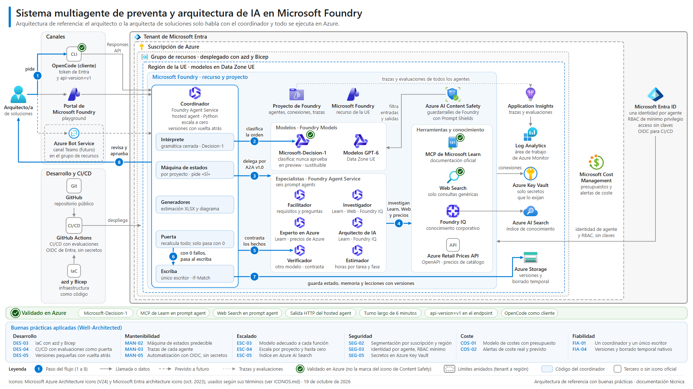

# Arquitectura de referencia



Versión en inglés: [arquitectura.en.png](arquitectura.en.png). Editable en diagrams.net:
[arquitectura.drawio](arquitectura.drawio), con una página por idioma.

Este diagrama es la **arquitectura de referencia** del sistema, con las buenas prácticas de Azure ya
aplicadas. No es una foto de lo que hoy está desplegado: lo que ya se ha probado en Azure lleva una marca
verde, y lo que la implementación actual hace de otra manera se explica al final, en
[En qué difiere hoy la implementación](#en-qué-difiere-hoy-la-implementación).

Es documentación técnica, no una pieza de marketing. Los términos de los iconos de Microsoft Entra lo
exigen (ver [ICONOS.md](ICONOS.md)). La especificación ([arquitectura.json](arquitectura.json)) no
contiene nombres de empresas ni de personas, identificadores de tenant o de suscripción, tarifas, correos
ni secretos.

## Cómo leerlo

**Los límites van de fuera adentro.** Cada marco es un límite de seguridad y de gobierno:

1. **Tenant de Microsoft Entra.** Dentro está Microsoft Entra ID, que da a cada agente su identidad de
   agente y autoriza el acceso con Azure RBAC de mínimo privilegio, sin claves. Es un servicio global del
   tenant, no de una región; por eso queda fuera de la suscripción. La flecha de Entra ID al marco de
   Foundry representa esa identidad de agente.
2. **Suscripción de Azure.** Aquí actúan los presupuestos y las alertas de Microsoft Cost Management. Un
   presupuesto avisa al pasar un umbral, pero no detiene el consumo: Learn lo dice así en REF-09.
3. **Grupo de recursos.** Contiene todos los recursos de la carga y se despliega entero con azd y Bicep.
   Por eso la flecha «despliega» de GitHub Actions termina en este marco, no en la suscripción.
4. **Región de la UE.** Contiene el recurso y el proyecto de Microsoft Foundry y los servicios de datos y
   observabilidad. Los modelos se despliegan en la Data Zone de la UE, así que la inferencia no sale de
   la UE.

Los canales y la cadena de desarrollo quedan **fuera del tenant**:

- **Canales.** OpenCode en el puesto del arquitecto, el portal de Foundry y, más adelante, Teams.
- **Cadena de desarrollo.** GitHub y GitHub Actions entran por federación OIDC con Microsoft Entra, sin
  secretos guardados.

**Lo que dibuja cada forma:**

- Los **iconos** son los oficiales de Microsoft, cada uno con el nombre completo de su servicio en su
  etiqueta o en la cabecera de su grupo: «Foundry Agent Service» en el coordinador y en la cabecera de los
  especialistas, «Foundry Models» en la de los modelos. El generador lo comprueba y falla si falta.
- Las **formas neutras con texto** son terceros o piezas sin icono propio: OpenCode («CLI»), GitHub,
  GitHub Actions, azd y Bicep, y la Azure Retail Prices API, que no tiene icono oficial y no toma prestado
  el de otro producto.
- **Límites:** el tenant se dibuja con trazo continuo y los marcos de dentro (suscripción, grupo de
  recursos y región) con trazo discontinuo. La leyenda muestra las dos variantes.
- Las **cajas claras dentro del coordinador** son código determinista, no modelos.

## El flujo, paso a paso

La persona que usa el sistema, el **arquitecto o la arquitecta de soluciones**, solo habla con un agente:
el **Coordinador**. Es un *hosted agent* en Python. Todo lo que decide, guarda o recalcula es código; los
modelos solo proponen.

1. **Pide.** Lo hace desde OpenCode como cliente (un plugin pone el token de Entra y el parámetro
   `api-version=v1`) o desde el playground del portal de Foundry. Teams, mediante Azure Bot Service,
   queda para más adelante; el recurso de Bot Service se dibuja en «Canales» por claridad, pero se
   desplegará en el grupo de recursos, como indica su rótulo.
2. **El intérprete clasifica la orden.** Prueba primero una gramática cerrada. Si no casa,
   Microsoft-Decision-1 clasifica la orden. Decision-1 solo clasifica: puede bloquear o escalar, pero nunca
   aprobar. La orden solo se ejecuta tras una confirmación «SÍ» de la persona. Como Decision-1 está en
   *preview*, se trata como una dependencia sustituible.
3. **Delega por A2A v1.0.** Quien delega es la máquina de estados del coordinador, y lo hace en seis
   especialistas, todos *prompt agents* de Foundry Agent Service: Facilitador, Investigador, Experto en
   Azure, Arquitecto de IA, Estimador y Verificador. Cada delegación abre un contexto nuevo, y ningún
   especialista escribe nada.
4. **Los especialistas investigan.** Usan el MCP de Microsoft Learn, Web Search (solo con consultas
   genéricas, sin datos de cliente), la Azure Retail Prices API (OpenAPI) y Foundry IQ, el conocimiento
   corporativo indexado en Azure AI Search.
5. **El Verificador contrasta** cada hecho con su fuente, con un modelo distinto del de los generadores.
6. **La puerta recalcula.** Son comprobaciones deterministas: horas y holguras, cobertura de requisitos,
   presencia de cada nodo del diagrama, precios contra el catálogo de Azure, citas contra Learn, fechas de
   retirada de los modelos… Solo pasa con 0 fallos.
7. **El escriba guarda** el estado del proyecto, la memoria de cada agente y las lecciones en Azure
   Storage, con versiones de blobs y borrado temporal. Es el único escritor.
8. **La persona revisa y aprueba** los entregables (estimación XLSX y diagrama). Es el humano en el bucle:
   nada se entrega sin su aprobación explícita.

Además:

- **Guardarraíles.** Todas las llamadas a modelos pasan por los guardarraíles de Foundry, que usan Azure AI
  Content Safety y Prompt Shields para filtrar entradas y salidas.
- **Observabilidad.** El proyecto envía trazas y evaluaciones de todos los agentes a Application Insights,
  que guarda la telemetría en un área de trabajo de Log Analytics (Azure Monitor).
- **Secretos.** Solo los secretos que lo exijan (por ejemplo, una conexión que no admita Entra) viven en
  un Azure Key Vault propio conectado a Foundry. La conexión es del recurso de Foundry (REF-05), y por eso
  la flecha «conexiones» sale del marco de Foundry y no del recuadro de herramientas. Todo lo demás va con
  identidad de Entra y RBAC, sin claves.
- **Versiones y escalado.** Cada agente se publica como una versión, y se puede volver a la anterior. El
  coordinador, como *hosted agent*, escala a cero cuando no hay turnos (REF-15).

## Validado en Azure

Lo que ya se ha probado en Azure lleva un sello verde con aro en el diagrama y aparece en la banda
inferior. El icono oficial de Azure AI Content Safety trae de serie una marca verde que no se puede
quitar sin alterarlo; no significa que los guardarraíles estén validados, y la leyenda lo aclara junto
al sello «Validado en Azure».

- Microsoft-Decision-1, con Entra y sin clave.
- El MCP de Learn y Web Search en un *prompt agent*.
- La salida HTTP del *hosted agent*.
- Un turno largo de 6 minutos en segundo plano.
- El parámetro `api-version=v1`, que el endpoint del *hosted agent* exige.
- OpenCode como cliente del *hosted agent*.

Lo demás es la arquitectura prevista. El canal de Teams, con trazo discontinuo, queda para más adelante.

## Buenas prácticas aplicadas (Well-Architected)

La banda inferior del diagrama muestra seis pilares con nombre propio. Desarrollo y Mantenibilidad son las
dos caras de *Operational Excellence*; Escalado corresponde a *Performance Efficiency*. Cada práctica sale
del catálogo verificado de buenas prácticas (versión 2026-10-18): la URL es de Learn y la cita, literal,
se ha comprobado en esa página (HTTP 200 y cita encontrada en las 30 prácticas del catálogo). En la banda
del diagrama cada práctica aparece abreviada para caber en 1920×1080 con letra de 13 px como mínimo; aquí
va completa. En el SVG y el HTML, cada línea de la banda lleva su URL y su cita como texto emergente.

| Pilar | Id | Cómo se aplica | Fuente en Learn | Cita literal |
|---|---|---|---|---|
| Desarrollo (Operational Excellence) | DES-03 (OE:05) | IaC con azd y Bicep para todo el grupo de recursos | [well-architected/operational-excellence/checklist](https://learn.microsoft.com/en-us/azure/well-architected/operational-excellence/checklist) | «Use a standardized infrastructure as code (IaC) approach to prepare resources and configurations.» |
| Desarrollo (Operational Excellence) | DES-04 (OE:06) | CI/CD en GitHub Actions con evaluaciones como puerta | [well-architected/operational-excellence/checklist](https://learn.microsoft.com/en-us/azure/well-architected/operational-excellence/checklist) | «Ensure these pipelines test and promote changes across all environments and quality gates.» |
| Desarrollo (Operational Excellence) | DES-05 (OE:11) | Versiones de agente pequeñas y con vuelta atrás | [well-architected/operational-excellence/checklist](https://learn.microsoft.com/en-us/azure/well-architected/operational-excellence/checklist) | «Focus on small, incremental releases with quality gates.» |
| Mantenibilidad (Operational Excellence) | MAN-02 (OE:02) | Máquina de estados: un paso por turno, predecible | [well-architected/operational-excellence/checklist](https://learn.microsoft.com/en-us/azure/well-architected/operational-excellence/checklist) | «Use standardization as a way to make routine, ad-hoc, and emergency operations consistent and predictable.» |
| Mantenibilidad (Operational Excellence) | MAN-03 (OE:07) | Trazas de cada agente en Application Insights | [well-architected/operational-excellence/checklist](https://learn.microsoft.com/en-us/azure/well-architected/operational-excellence/checklist) | «Design a monitoring stack that captures operational telemetry, metrics, and logs» |
| Mantenibilidad (Operational Excellence) | MAN-05 (OE:10) | Automatización segura: OIDC con Entra, sin secretos | [well-architected/operational-excellence/checklist](https://learn.microsoft.com/en-us/azure/well-architected/operational-excellence/checklist) | «Design automation to be reliable, secure, and maintainable across the workload lifecycle.» |
| Escalado (Performance Efficiency) | ESC-03 (PE:03) | Modelo adecuado a cada función: clasificar o generar | [well-architected/performance-efficiency/checklist](https://learn.microsoft.com/en-us/azure/well-architected/performance-efficiency/checklist) | «The services, infrastructure, and tier selections must support your ability to reach the workload's performance targets» |
| Escalado (Performance Efficiency) | ESC-04 (PE:05) | Unidad de escala: el proyecto; el hosted agent escala a cero | [well-architected/performance-efficiency/checklist](https://learn.microsoft.com/en-us/azure/well-architected/performance-efficiency/checklist) | «The scale unit design of the workload is the basis of the scaling and partitioning strategy.» |
| Escalado (Performance Efficiency) | ESC-05 (PE:08) | Índice de conocimiento en Azure AI Search (Foundry IQ) | [well-architected/performance-efficiency/checklist](https://learn.microsoft.com/en-us/azure/well-architected/performance-efficiency/checklist) | «Optimize data stores, partitions, and indexes for their intended and actual use in the workload.» |
| Seguridad (Security) | SEG-02 (SE:04) | Segmentación por suscripción y región (límites: tenant, suscripción, grupo de recursos y región) | [well-architected/security/checklist](https://learn.microsoft.com/en-us/azure/well-architected/security/checklist) | «Create intentional segmentation and perimeters in your architecture design» |
| Seguridad (Security) | SEG-03 (SE:05) | Identidad de Entra por agente y RBAC mínimo, sin claves | [well-architected/security/checklist](https://learn.microsoft.com/en-us/azure/well-architected/security/checklist) | «Implement strict, conditional, and auditable identity and access management (IAM)» |
| Seguridad (Security) | SEG-05 (SE:09) | Secretos y conexiones en Azure Key Vault | [well-architected/security/checklist](https://learn.microsoft.com/en-us/azure/well-architected/security/checklist) | «Protect application secrets by hardening their storage and restricting access and manipulation» |
| Coste (Cost Optimization) | COS-01 (CO:02) | Modelo de costes con presupuesto | [well-architected/cost-optimization/checklist](https://learn.microsoft.com/en-us/azure/well-architected/cost-optimization/checklist) | «A cost model should estimate the initial cost, run rates, and ongoing costs.» |
| Coste (Cost Optimization) | COS-02 (CO:03) | Alertas de coste real y previsto | [well-architected/cost-optimization/checklist](https://learn.microsoft.com/en-us/azure/well-architected/cost-optimization/checklist) | «Automate alerts to trigger notifications at key thresholds» |
| Fiabilidad (Reliability) | FIA-01 (RE:01) | Diseño simple: un coordinador y un único escritor | [well-architected/reliability/checklist](https://learn.microsoft.com/en-us/azure/well-architected/reliability/checklist) | «Focus your workload design on simplicity and efficiency.» |
| Fiabilidad (Reliability) | FIA-04 (RE:07) | Versiones y borrado temporal nativos de Azure Storage para recuperar | [well-architected/reliability/checklist](https://learn.microsoft.com/en-us/azure/well-architected/reliability/checklist) | «Use built-in features and well-established cloud patterns to help your workload remain functional» |

### Prácticas adicionales que muestra el diagrama

Estas prácticas no están en el catálogo, así que se han comprobado aparte en learn.microsoft.com el
19-10-2026: la página devolvió HTTP 200 y la cita aparece literal en su texto visible. El SHA-256 de cada
página descargada está en la sección `practicas.referencia` de [arquitectura.json](arquitectura.json).

| Id | Pilar | Práctica | Fuente en Learn | Cita literal |
|---|---|---|---|---|
| REF-01 | Seguridad | Guardarraíles de contenido de Foundry sobre Azure AI Content Safety | [azure/foundry/guardrails/guardrails-overview](https://learn.microsoft.com/en-us/azure/foundry/guardrails/guardrails-overview) | «Guardrails leverage classification models from Azure AI Content Safety to detect harmful content across supported risk categories.» |
| REF-02 | Seguridad | Prompt Shields contra ataques de instrucciones | [azure/ai-services/content-safety/concepts/jailbreak-detection](https://learn.microsoft.com/en-us/azure/ai-services/content-safety/concepts/jailbreak-detection) | «Prompt Shields detect attempts to manipulate your model's behavior through adversarial inputs.» |
| REF-03 | Seguridad | Identidad de agente de Microsoft Entra para cada agente | [azure/foundry/agents/concepts/agent-identity](https://learn.microsoft.com/en-us/azure/foundry/agents/concepts/agent-identity) | «An agent identity is a specialized identity type in Microsoft Entra ID that's designed specifically for AI agents.» |
| REF-04 | Seguridad | Azure RBAC de mínimo privilegio | [azure/role-based-access-control/best-practices](https://learn.microsoft.com/en-us/azure/role-based-access-control/best-practices) | «it's a best practice to grant users the least privilege to get their work done.» |
| REF-05 | Seguridad | Conexión de Azure Key Vault propio en Foundry | [azure/foundry/how-to/set-up-key-vault-connection](https://learn.microsoft.com/en-us/azure/foundry/how-to/set-up-key-vault-connection) | «To manage your own secrets, connect your Azure Key Vault to Foundry.» |
| REF-06 | Desarrollo | GitHub Actions con OIDC y credencial federada de Entra | [azure/developer/github/connect-from-azure-openid-connect](https://learn.microsoft.com/en-us/azure/developer/github/connect-from-azure-openid-connect) | «To use Azure Login action with OIDC, you need to configure a federated identity credential on a Microsoft Entra application or a user-assigned managed identity.» |
| REF-07 | Mantenibilidad | Application Insights sobre un área de trabajo de Log Analytics | [azure/azure-monitor/app/create-workspace-resource](https://learn.microsoft.com/en-us/azure/azure-monitor/app/create-workspace-resource) | «Application Insights integrates with Log Analytics and sends telemetry to a common Log Analytics workspace.» |
| REF-08 | Mantenibilidad | Trazas, evaluaciones y puertas de calidad en CI/CD | [azure/foundry/concepts/observability](https://learn.microsoft.com/en-us/azure/foundry/concepts/observability) | «You can trace, evaluate, integrate automated quality gates into CI/CD pipelines» |
| REF-09 | Coste | Presupuestos con alertas de coste real y previsto (avisan; no detienen el consumo) | [azure/cost-management-billing/costs/tutorial-acm-create-budgets](https://learn.microsoft.com/en-us/azure/cost-management-billing/costs/tutorial-acm-create-budgets) | «You can configure alerts based on your actual cost or forecasted cost to ensure that your spending is within your organizational spending limit.» |
| REF-10 | Seguridad | Residencia de datos: despliegues Data Zone en la UE | [azure/foundry/foundry-models/concepts/deployment-types](https://learn.microsoft.com/en-us/azure/foundry/foundry-models/concepts/deployment-types) | «Data Zone types: The service processes data only within the Microsoft-specified data zone (US, EU, or Asia Pacific (APAC)).» |
| REF-11 | Fiabilidad | Versiones de blobs para recuperar datos | [azure/storage/blobs/versioning-overview](https://learn.microsoft.com/en-us/azure/storage/blobs/versioning-overview) | «When you enable blob versioning, you can access earlier versions of a blob to recover your data if it's modified or deleted.» |
| REF-12 | Fiabilidad | Borrado temporal de blobs | [azure/storage/blobs/soft-delete-blob-overview](https://learn.microsoft.com/en-us/azure/storage/blobs/soft-delete-blob-overview) | «Blob soft delete protects an individual blob, snapshot, or version from accidental deletes or overwrites by keeping the deleted data in the system for a specified period of time.» |
| REF-13 | Desarrollo | Versiones de hosted agent con vuelta atrás | [azure/foundry/agents/concepts/hosted-agents](https://learn.microsoft.com/en-us/azure/foundry/agents/concepts/hosted-agents) | «containerization, web server setup, security, memory persistence, scaling, instrumentation, and version rollbacks» |
| REF-14 | Seguridad | Humano en el bucle antes de acciones de alto impacto | [azure/well-architected/ai/responsible-ai](https://learn.microsoft.com/en-us/azure/well-architected/ai/responsible-ai) | «Human-in-the-loop checkpoints where agents pause execution for validation before proceeding with high-risk or high-impact actions.» |
| REF-15 | Escalado | Hosted agent con sesiones aisladas que escala a cero | [azure/foundry/agents/concepts/hosted-agents](https://learn.microsoft.com/en-us/azure/foundry/agents/concepts/hosted-agents) | «enabling scale-to-zero with stateful resume and predictable cold starts.» |

## En qué difiere hoy la implementación

El diagrama muestra el destino. La implementación actual se aparta de él en estos puntos, y cada uno es
una decisión consciente o una limitación de permisos, no un descuido:

| Arquitectura de referencia | Implementación actual | Motivo |
|---|---|---|
| Acceso a los datos con identidad de Entra y Azure RBAC, sin claves (SEG-03) | Las conexiones a Storage y a Azure AI Search usan clave: clave de cuenta solo para firmar SAS de minutos por contenedor, y *query key* de solo lectura para la búsqueda. La ingesta de Foundry IQ solo admite clave | No hay permisos para asignar roles de datos sobre esos recursos. Se compensa con SAS por turno y contenedor y con pruebas negativas que esperan un 403 |
| Secretos en un Azure Key Vault propio conectado a Foundry (SEG-05) | No hay un Key Vault propio conectado: el repositorio no crea ni usa ninguno. El valor de cada conexión llega al proceso como variable de entorno; el coordinador la lee, la borra del entorno y comprueba que funciona antes de trabajar | Pendiente. Learn indica que, sin esa conexión, Foundry guarda los datos de conexión en un Key Vault gestionado por Microsoft, fuera de la suscripción (REF-05) |
| CI/CD con GitHub Actions y federación OIDC (DES-04, MAN-05) | El coordinador se despliega por ZIP (con dependencias empaquetadas y sus hashes) desde el portátil de desarrollo | Todavía no hay canalización. La vuelta atrás es manual: se vuelve a la versión anterior del agente, al ZIP anterior por su hash y a la versión anterior del blob |
| Infraestructura como código con azd y Bicep (DES-03) | Los recursos, las conexiones y las asignaciones de roles se crean a mano con scripts de la CLI de Azure documentados en el repositorio | El repositorio aún no tiene plantillas azd ni Bicep |
| Grupo de recursos propio con mínimo privilegio (SEG-02) | Tenant y suscripción compartidos con otras cargas, con varias identidades con rol de propietario o colaborador | Es el entorno disponible. Por eso las trazas no llevan datos de cliente: cualquiera con lectura de Log Analytics podría verlas |
| Guardarraíles de contenido con Prompt Shields (REF-01, REF-02) | No se ha configurado ni probado una política propia | Pendiente |
| Presupuestos y alertas de Microsoft Cost Management (COS-01, COS-02) | No están configurados | Pendiente |
| Evaluaciones como puerta de calidad (REF-08) | La calidad de los modelos se mide con un banco de pruebas propio (comprobaciones deterministas y juicio A/B ciego), que se lanza a mano | Las evaluaciones de Foundry aún no forman parte de una canalización |
| Modelos GPT-6 en Data Zone UE | La comparativa entre modelos sigue en curso | Decisión pendiente |

## Cómo regenerarlo

Hacen falta los dos juegos oficiales de iconos descomprimidos fuera del repositorio (ver
[ICONOS.md](ICONOS.md)). Desde la raíz del repositorio:

```bash
python docs/arquitectura/generar_diagrama.py   --iconos "<carpeta>/Azure_Public_Service_Icons/Icons"   --iconos-entra "<carpeta>/Microsoft Entra architecture icons - Oct 2023" --png
```

- Sin `--iconos`, usa la variable `ICONOS_AZURE`; sin `--iconos-entra`, la variable `ICONOS_ENTRA`. Cada
  icono de [arquitectura.json](arquitectura.json) indica de qué juego sale, y su SHA-256 se comprueba en
  los dos juegos.
- `--png` renderiza `arquitectura.es.png` y `arquitectura.en.png` (1920×1080) con Microsoft Edge en modo
  headless. La ruta de Edge se cambia con `--edge` o con `EDGE_PATH`.
- El generador solo usa la biblioteca estándar y es determinista: la misma entrada produce los mismos
  bytes.
- **Código de salida = veredicto.**
  - 0: todo correcto.
  - 1: la especificación o una salida no pasan las comprobaciones.
  - 2: error de entorno (falta un juego de iconos o Edge, o no se puede leer o escribir un fichero).
- Antes de escribir, comprueba:
  - que todo nodo, toda arista, su texto y su paso aparecen en cada salida, y que el flujo va del 1 al 8
    sin repetir;
  - que los límites están anidados en orden (tenant, suscripción, grupo de recursos, región), que nada
    pisa la cabecera de su límite y que ningún nodo invade un grupo que no es el suyo;
  - que la banda tiene seis pilares con 2 o 3 prácticas cada uno, con URL de Learn y cita, y que cada
    práctica que cita un nodo existe;
  - que ningún texto se sale de su marco ni pisa otro nodo o el título de un grupo, que las bandas de abajo
    no pisan el diagrama, que los id son únicos y que no hay marcado activo.

  Si algo falla, no escribe nada.

Las pruebas están en `tests/test_diagrama.py`:

```bash
.venv/Scripts/python.exe -m pytest tests/test_diagrama.py
```

La prueba que compara la banda con el catálogo verificado de buenas prácticas busca
`catalogo_practicas.json` y `catalogo_evidencia.json` en `pruebas/modelos/`, en la variable
`CATALOGO_PRACTICAS` o en la copia vecina del repositorio; si no los encuentra, se salta y lo dice.

## Crédito de los iconos

Iconos: **Microsoft Azure Architecture Icons** (V24) y **Microsoft Entra architecture icons** (octubre de
2023), usados según sus términos de uso. Los términos se reproducen literalmente en
[ICONOS.md](ICONOS.md), junto con la lista de iconos y cómo se respetan.
